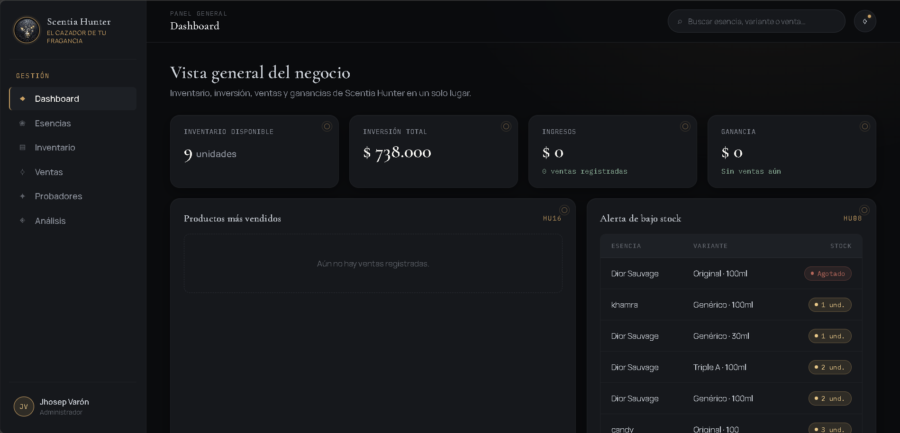

# Scentia Hunter — Frontend

Panel web para que un emprendimiento de perfumería controle esencias, variantes, inventario, ventas y ganancias, y analice qué vender y qué comprar.



- Aplicación en vivo (Vercel): https://scentia-hunter-frontend.vercel.app
- Aplicación en vivo (Azure App Service): https://scentia-hunter-front-jvaronm-a5bvexccb4c3g6dy.centralus-01.azurewebsites.net
- API (repositorio del backend): https://github.com/Tosty144/scentia-hunter-backend
- Mockups de baja fidelidad: [docs/mockups](docs/mockups)

## Qué hace

| Módulo | Funciones |
|---|---|
| Dashboard | Inventario disponible, inversión total, ingresos, ganancia, productos más vendidos y alerta de bajo stock |
| Esencias | Registro de esencias con varias variantes (tipo, presentación, costo, precio y stock) y probador |
| Inventario | Entradas y salidas de stock, movimientos e inversión por producto |
| Ventas | Registro de ventas que descuenta stock y calcula ingreso y ganancia; historial por fechas |
| Probadores | Esencias con y sin probador disponible |
| Análisis | Ranking de ventas, rentabilidad por variante y esencias sin movimiento |

El sistema no procesa pagos, no es una tienda virtual y no gestiona envíos. Todos los datos de la demo son ficticios.

## Cómo ejecutarlo

Requisitos: Node.js 20 o superior y el backend corriendo (local o en la nube).

```bash
git clone https://github.com/Tosty144/scentia-hunter-frontend.git
cd scentia-hunter-frontend
npm install
cp .env.example .env.local      # en Windows: copy .env.example .env.local
# edita VITE_API_URL con la URL del backend, por ejemplo http://localhost:4000
npm run dev                     # abre http://localhost:5173
```

Otros comandos:

| Comando | Para qué sirve |
|---|---|
| `npm run build` | Genera la versión de producción en `dist/` |
| `npm run preview` | Sirve localmente el build de producción |
| `npm run lint` | Revisa el código con ESLint |
| `npm test` | Ejecuta las pruebas unitarias (Vitest + Testing Library) |
| `npm run test:coverage` | Pruebas con reporte de cobertura en `out/coverage` |

## Tecnologías

- React 18 y React Router 7
- Vite 5
- Vitest, Testing Library y jsdom para pruebas; ESLint; Husky para hooks de Git
- Despliegue en Vercel y en Azure App Service mediante Azure Pipelines (build, pruebas, SonarCloud, OWASP ZAP y Lighthouse)
- Desarrollo en WSL (Ubuntu) con OpenCode como asistente de programación

## Estructura

```
src/
├── assets/        # logo
├── components/    # layout (Sidebar, Topbar) y componentes UI (StatCard, DataTable, Badge…)
├── pages/         # Login, Dashboard, Esencias, Inventario, Ventas, Probadores, Análisis
├── router/        # rutas de la aplicación
├── services/      # api.js: cliente HTTP hacia el backend
└── tests/         # pruebas unitarias
```

## Autor

Jhosep Varón

## Referencias

37signals. (s.f.). *Fizzy: A modern spin on kanban for tracking anything*. https://www.fizzy.do

Excalidraw. (s.f.). *Excalidraw*. https://excalidraw.com

Meta Open Source. (s.f.). *React*. https://react.dev

Microsoft. (s.f.). *How to install Linux on Windows with WSL*. Microsoft Learn. https://learn.microsoft.com/en-us/windows/wsl/install

OpenCode. (s.f.). *OpenCode: The open source AI coding agent*. https://opencode.ai

Remix Software. (s.f.). *React Router*. https://reactrouter.com

Vercel. (s.f.). *Vercel documentation*. https://vercel.com/docs

VoidZero. (s.f.). *Vite*. https://vite.dev

VoidZero. (s.f.). *Vitest*. https://vitest.dev
